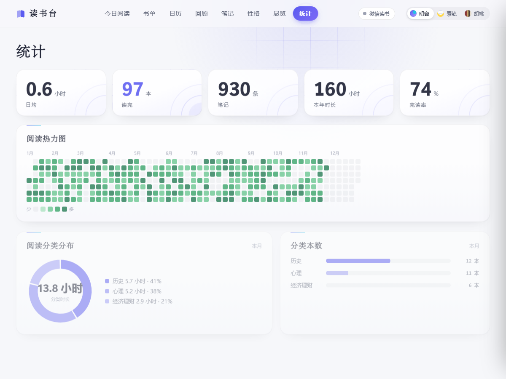

# 读书台 · dsh-reading-desk

微信读书的**阅读计划 / 月历 / 划线回顾 / 笔记 / 月度策展**，做成一个 DeepSeek Harness（`dsh`）插件，
常驻在侧栏面板里。

> 插件包名、仓库名统一为 `dsh-reading-desk`。



## 它解决什么

微信读书本身不帮你「安排读什么」，也不帮你「回头看一眼旧划线」。这个面板补这两件事：

| 页面 | 干什么 |
|---|---|
| 今日 | 今天该读哪几本、今天要回顾几条 |
| 本月书单 | 搜书 → 用日期区间排进本月 → 看进度与时长；支持批量改期 |
| 月度日历 | 每天读了哪几本、读了多少分钟；点某天看当天书目 |
| 每日划线回顾 | 按 **FSRS** 排到期卡片，看原文 → 写一句 → 四档评分 |
| 笔记 | 与 AI 讨论后留下的笔记，可选同步目标（本机 / Get 笔记 / flomo） |
| 阅读性格 | 人格卡 + 五维 + 今年之最 + 营养表 + 心电图 + 历年，可导出 1080×1440 图片 |
| 阅读展 | 月度策展海报：主题、封面带、本月精选（优先真实划线） |
| 统计 | 五指标、全年热力图、分类分布、读书墙（按月/按年） |

## 安装

```bash
# 从 GitHub 安装
dsh plugin add github:limowan/dsh-reading-desk

# 或本地目录
dsh plugin add /path/to/dsh-reading-desk
```

没有发布到 npm，所以不要用 `dsh plugin add dsh-reading-desk` 这种短名；
用 `github:limowan/dsh-reading-desk`（已验证可从 GitHub 直接安装，不需要 npm 账号）。

装完在侧栏点「读书台」图标。第一次只有内置的公开样张；要显示自己的数据，
在面板里点「连接微信读书」填 Agent Gateway 的 `wrk-` Key 同步一次。

## AI

阅读性格的吐槽、阅读展的策展主题、笔记整理、书内讨论，全部走宿主侧的 `ctx.llm.stream`：

- 用的是你 `dsh` 里已经配好的 provider / model（`ctx.agentDefaultModel.currentSelection()`）
- **不需要再配一个 API Key**，也不产生额外计费通道
- 模型不可用时自动退回本地文案，功能不中断

## 隐私

- 微信读书 Key 与同步下来的数据**只存在你这台机器的浏览器里**（localStorage）
- 宿主只做转发：`/plugin/reading-desk/weread` 把只读请求原样转给微信读书网关，
  限 6 个只读接口、4KB 上限、校验 Origin，不落盘、不记日志
- AI 请求只带书名、统计数字和对话内容，不带 Key

## 已知限制

- 数据要手动同步一次；清了浏览器数据就得重同步
- 内置 `assets/covers` 是样张封面，版权归微信读书与出版方，仅用于界面展示
- 只在 `dsh 0.2.2-rc.1` 上验证过；更早版本没测
- 在真实面板里的框高、明暗主题跟随还需要你实测

## 开发

```bash
# 改界面：直接编辑 assets/index.html（单文件，原型在 ../预览/）
# 改宿主：编辑 index.js 后在插件管理里禁用再启用一次，或重启 dsh
```

结构：

```
index.js          宿主：托管 assets/ + 微信读书转发 + 4 条 AI 路由
client.js         浏览器：侧栏图标 + main 面板（iframe 载入界面）
assets/           界面本体（index.html / sample-data.js / covers/）
locale/{zh,en}.json  插件标题与描述
docs/DETAIL.md    插件详情页
```

## License

MIT
